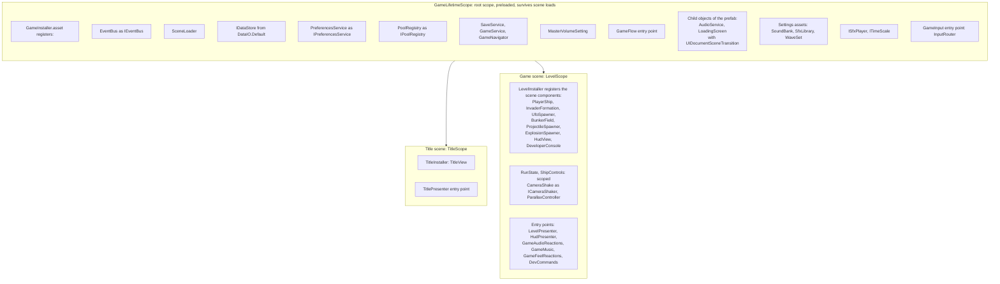
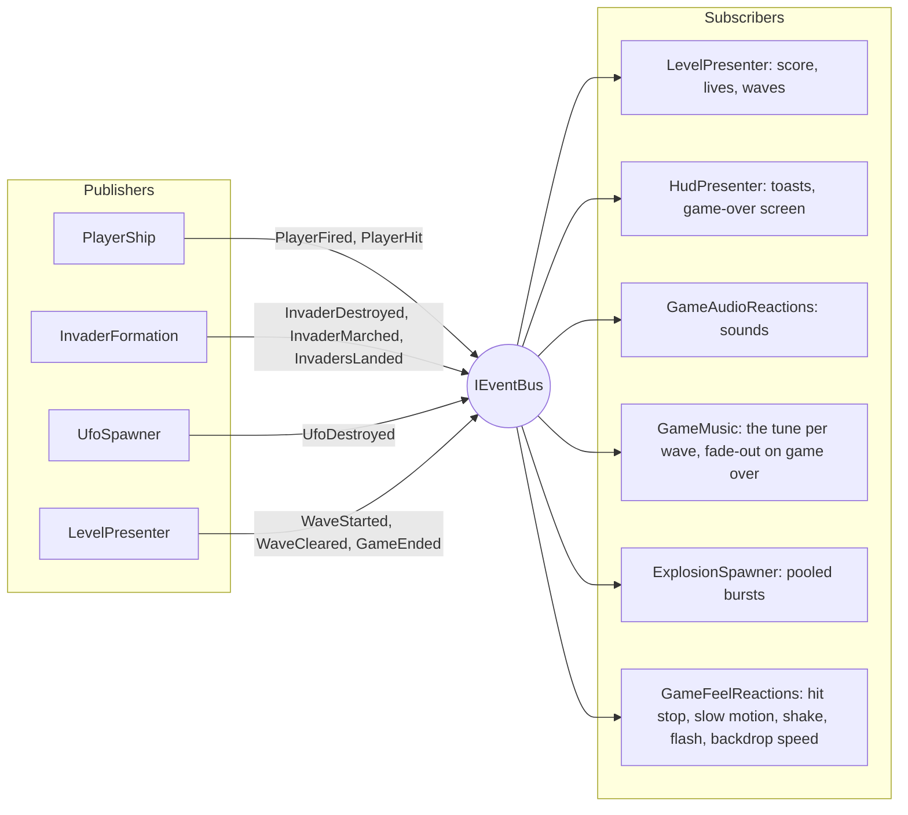
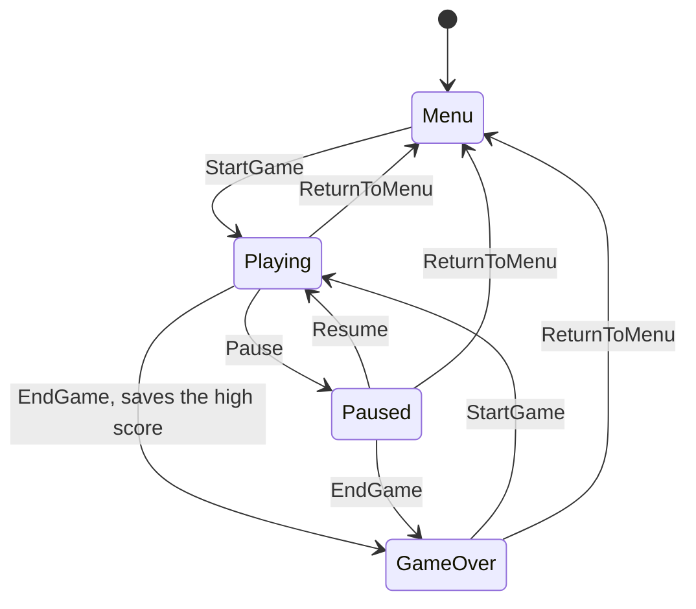
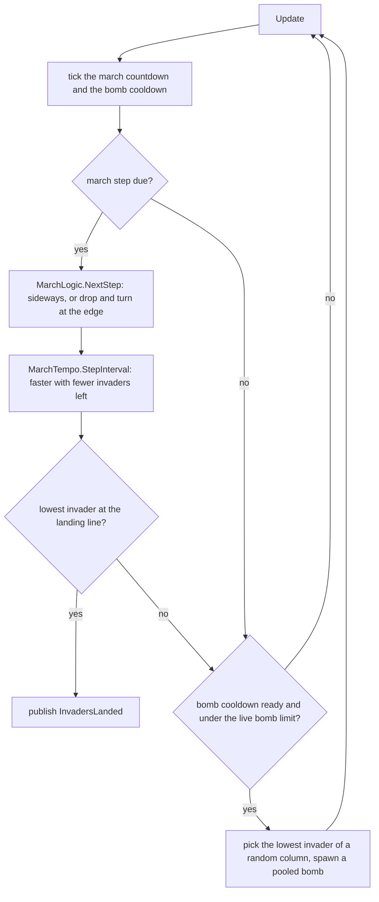
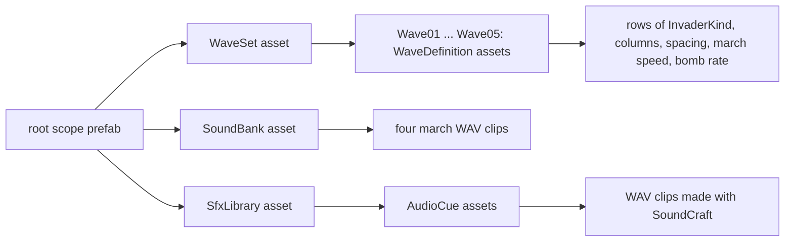

# Architecture

The game is built from small pieces that talk through a few narrow seams: a dependency-injection container, an event bus, and a handful of interfaces. This page shows those seams as diagrams. File names are relative to `Assets/_Scripts/Runtime`.

## The layers

```mermaid
graph TD
    subgraph Pretzel["Pretzel modules"]
        core["Core: timers, Guard, CompositeDisposable"]
        events["Events: EventBus"]
        pooling["Pooling: PoolFactory, PoolRegistry"]
        scenes["Scenes: SceneLoader, loading screen"]
        ui["UI: UIControllerBase, UIScreenStack, ToastService"]
        audio["Audio: AudioService, AudioCue"]
        data["Data: DataIO, IDataStore"]
        prefs["Preferences: PreferencesService"]
        dev["DevConsole: DeveloperConsole"]
        integ["VContainer module: scopes and installers"]
        sfx["Sfx: SfxPlayer, SfxLibrary"]
        vfx["Vfx: TimeScaleService, SpriteFlash, PunchScale"]
        cams["Cameras: CameraShake, PlayfieldFitter"]
        parallax["Parallax: ParallaxController"]
        inputs["Inputs: InputRouter, SceneLoadInputGate"]
    end

    subgraph Game["Space Invaders"]
        comp["Composition: installer, services, flow"]
        presenters["Presenters: plain C# rules and wiring"]
        actors["Actors: MonoBehaviours in the scenes"]
        views["Views: UI Toolkit controllers"]
        rules["Rules: pure C# logic"]
    end

    comp --> integ
    comp --> data
    comp --> prefs
    comp --> scenes
    presenters --> events
    presenters --> rules
    presenters --> comp
    actors --> pooling
    actors --> events
    actors --> core
    views --> ui
    presenters --> views
    presenters --> actors
    presenters --> audio
    presenters --> dev
    presenters --> sfx
    presenters --> vfx
    presenters --> cams
    presenters --> parallax
    comp --> inputs
```



The rules know nothing about Unity objects, the actors and views are thin adapters, and the presenters connect them.

## Scopes and composition

VContainer builds one root scope before the first scene loads, then one child scope per scene. Everything that lives for the whole session is in the root; everything tied to a level is in the scene's scope and is disposed when that scene unloads.



How the pieces are created:

- `Composition/GameInstaller.Generated.cs` is written by **Pretzel Setup > VContainer** and never edited by hand. `Composition/GameInstaller.cs` is yours and adds the loading screen and the volume setting.
- `Composition/GameLifetimeScope.prefab` (in `_Project/Settings/Composition`) holds the installer, the settings assets and the child objects. `VContainerSettings` points at it and is in the project's preloaded assets, so the root exists before any scene.
- Scene components are registered by a `MonoInstaller` (`Gameplay/Level/LevelInstaller.cs`, `UI/TitleInstaller.cs`) and receive their dependencies through an `[Inject]` method.
- The plain C# classes (`LevelPresenter`, `HudPresenter`, ...) take their dependencies in the constructor. Nothing uses a service locator or a singleton.

## The event bus

The actors publish what happened. They never call the things that react. Messages are small `readonly struct`s in `Gameplay/Messages/`, so publishing allocates nothing.



| Message | Published by | Used by |
|---|---|---|
| `PlayerFired` | `PlayerShip` | audio |
| `PlayerHit` | `PlayerShip` | rules (lose a life), audio, effects |
| `InvaderDestroyed` | `InvaderFormation` | rules (score, wave cleared), audio, effects |
| `InvaderMarched` | `InvaderFormation` | audio (the four march notes) |
| `InvadersLanded` | `InvaderFormation` | rules (game over) |
| `UfoDestroyed` | `UfoSpawner` | rules (score), HUD toast, audio, effects |
| `WaveStarted` | `LevelPresenter` | HUD toast |
| `WaveCleared` | `LevelPresenter` | audio |
| `GameEnded` | `LevelPresenter` | HUD (game-over screen), audio |

Every subscriber keeps its subscriptions in a `CompositeDisposable` and disposes it once when it goes away.

## From the title to a wave

`GameNavigator` lives in the root scope, so the object that awaits a load survives it. The scene loader hides the scene change behind the loading screen and reports one progress value for both the scene file and the setup work.

```mermaid
sequenceDiagram
    actor Player
    participant Title as TitlePresenter
    participant Nav as GameNavigator
    participant Loader as SceneLoader
    participant Screen as LoadingScreen
    participant Setup as LevelSetup
    participant Level as LevelPresenter
    participant Formation as InvaderFormation

    Player->>Title: Play
    Title->>Nav: PlayAsync
    Nav->>Loader: LoadAsync Game with options
    Loader->>Screen: Show, fade in
    Loader->>Loader: load and activate the Game scene
    Note over Loader: LevelScope builds, components are injected
    Loader->>Setup: SetupAsync, PrepareAsync
    Setup->>Formation: PrewarmAsync, a few invaders per frame
    Formation-->>Screen: progress and status text
    Loader->>Screen: Hide, fade out
    Level->>Level: Start, StartGame, first wave
    Level->>Formation: Spawn wave 1
```

## Game state

`GameService` (generated by Pretzel Setup, then yours) owns the state. Pause works through `Time.timeScale`, so everything driven by scaled time stops by itself.



## One wave, frame by frame

`InvaderFormation` runs the march and the bombs. The decisions are in pure C# (`Rules/`), so the tests can run them without a scene.



## Data the designers own



All three assets are registered as settings on the root scope prefab, so any class can ask for `WaveSet`, `SoundBank` or `SfxLibrary` in its constructor. Select a wave asset to see the formation preview of the custom inspector.
