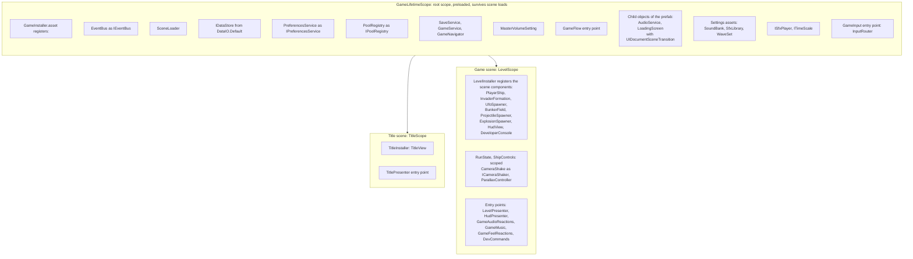
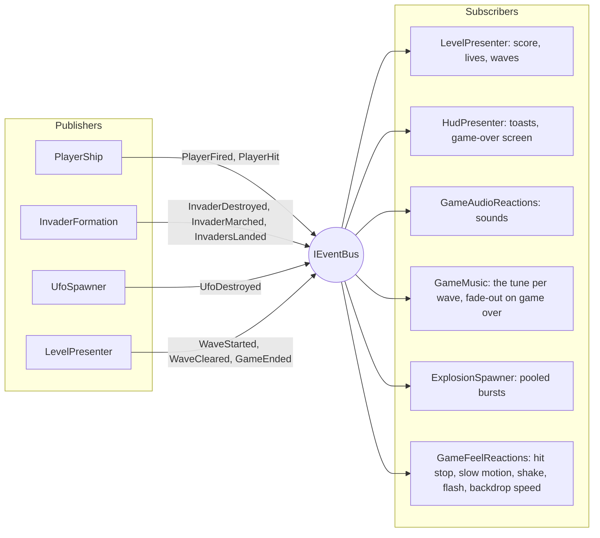
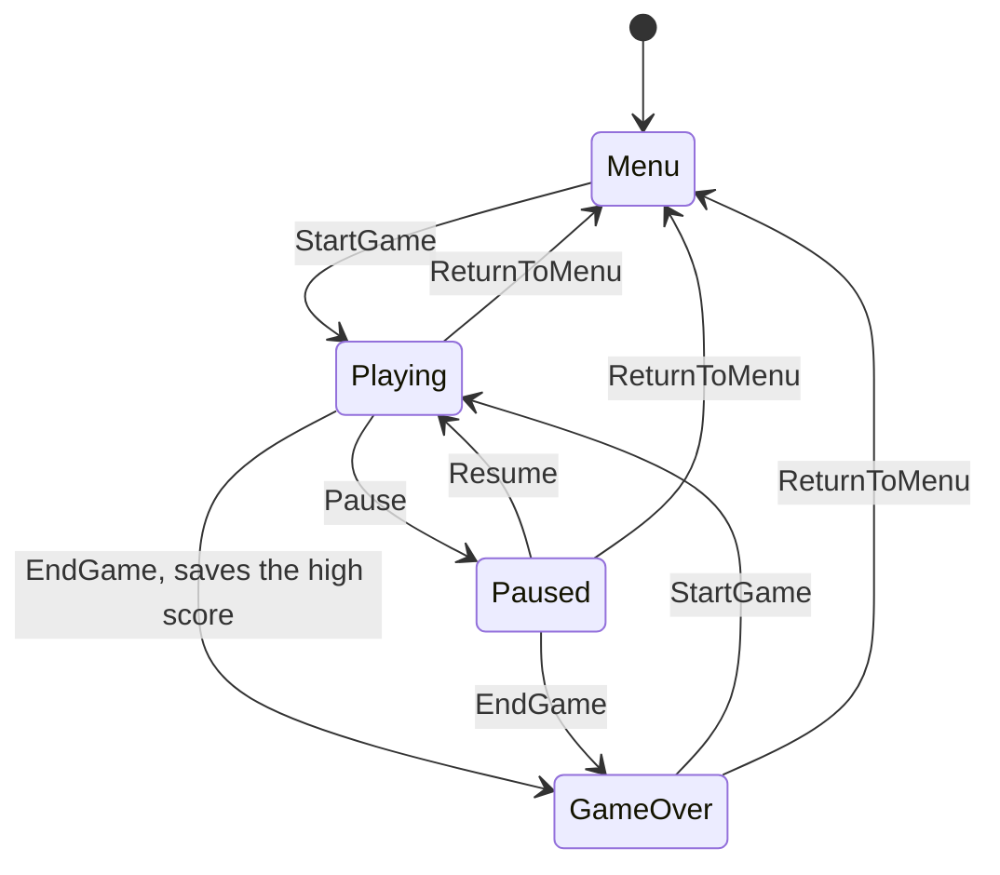
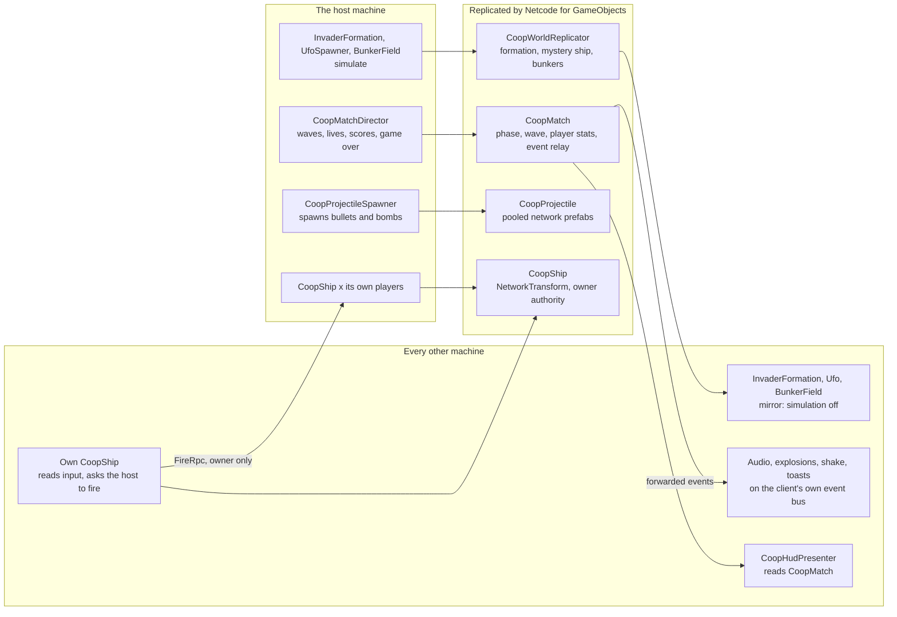
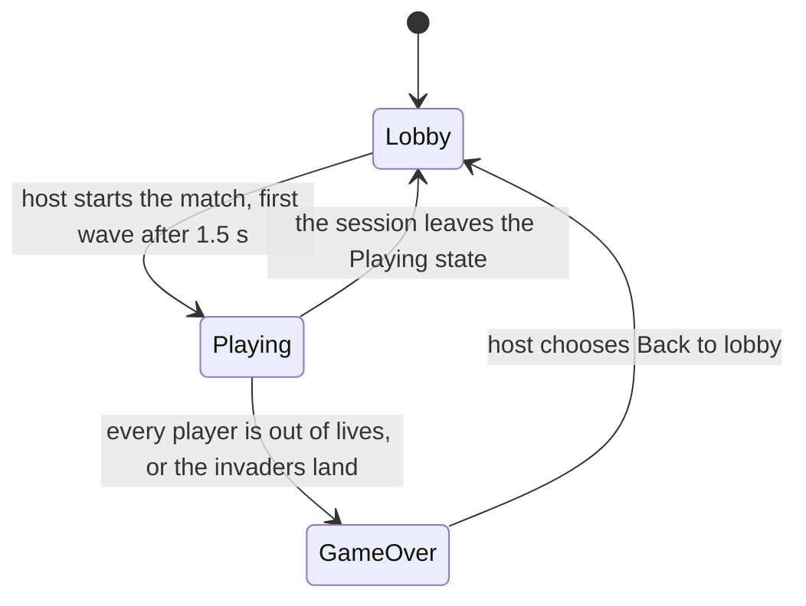
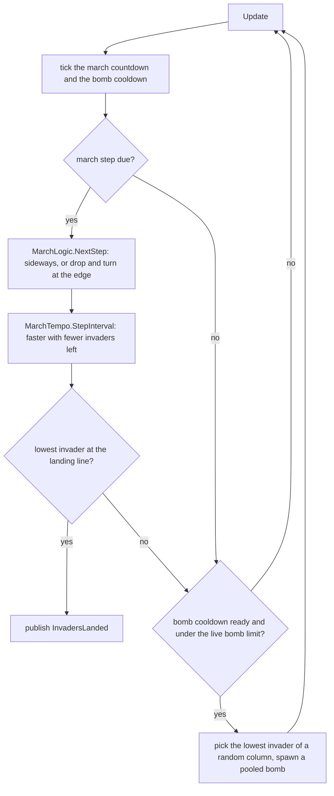
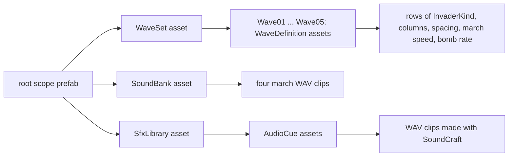

# Architecture

The game is built from small pieces that talk through a few narrow seams: a dependency-injection container, an event bus, and a handful of interfaces. This page shows those seams as diagrams. File names are relative to `Assets/_Scripts/Runtime`.

## The layers

```mermaid
graph TD
    subgraph Pretzel["Pretzel modules"]
        core["Core: timers, Guard, CompositeDisposable"]
        events["Events: EventBus"]
        pooling["Pooling: PoolFactory, PoolRegistry"]
        scenes["Scenes: SceneLoader, loading screen"]
        ui["UI: UIControllerBase, UIScreenStack, ToastService"]
        audio["Audio: AudioService, AudioCue"]
        data["Data: DataIO, IDataStore"]
        prefs["Preferences: PreferencesService"]
        dev["DevConsole: DeveloperConsole"]
        integ["VContainer module: scopes and installers"]
        sfx["Sfx: SfxPlayer, SfxLibrary"]
        vfx["Vfx: TimeScaleService, SpriteFlash, PunchScale"]
        cams["Cameras: CameraShake, PlayfieldFitter"]
        parallax["Parallax: ParallaxController"]
        inputs["Inputs: InputRouter, SceneLoadInputGate"]
        mp["Multiplayer: session service, menu, pooled network prefabs, player slots"]
    end

    subgraph Game["Space Invaders"]
        comp["Composition: installer, services, flow"]
        presenters["Presenters: plain C# rules and wiring"]
        actors["Actors: MonoBehaviours in the scenes"]
        views["Views: UI Toolkit controllers"]
        rules["Rules: pure C# logic"]
    end

    comp --> integ
    comp --> data
    comp --> prefs
    comp --> scenes
    presenters --> events
    presenters --> rules
    presenters --> comp
    actors --> pooling
    actors --> events
    actors --> core
    views --> ui
    presenters --> views
    presenters --> actors
    presenters --> audio
    presenters --> dev
    presenters --> sfx
    presenters --> vfx
    presenters --> cams
    presenters --> parallax
    comp --> inputs
    coop["Coop: shared match, world replication, host rules, network ship and projectiles"]
    coop --> mp
    coop --> events
    coop --> pooling
```



The rules know nothing about Unity objects, the actors and views are thin adapters, and the presenters connect them.

## Scopes and composition

VContainer builds one root scope before the first scene loads, then one child scope per scene. Everything that lives for the whole session is in the root; everything tied to a level is in the scene's scope and is disposed when that scene unloads.



How the pieces are created:

- `Composition/GameInstaller.Generated.cs` is written by **Pretzel Setup > VContainer** and never edited by hand. `Composition/GameInstaller.cs` is yours and adds the loading screen and the volume setting.
- `Composition/GameLifetimeScope.prefab` (in `_Project/Settings/Composition`) holds the installer, the settings assets and the child objects. `VContainerSettings` points at it and is in the project's preloaded assets, so the root exists before any scene.
- Scene components are registered by a `MonoInstaller` (`Gameplay/Level/LevelInstaller.cs`, `UI/TitleInstaller.cs`) and receive their dependencies through an `[Inject]` method.
- The plain C# classes (`LevelPresenter`, `HudPresenter`, ...) take their dependencies in the constructor. Nothing uses a service locator or a singleton.

## The event bus

The actors publish what happened. They never call the things that react. Messages are small `readonly struct`s in `Gameplay/Messages/`, so publishing allocates nothing.



| Message | Published by | Used by |
|---|---|---|
| `PlayerFired` | `PlayerShip` | audio |
| `PlayerHit` | `PlayerShip` | rules (lose a life), audio, effects |
| `InvaderDestroyed` | `InvaderFormation` | rules (score, wave cleared), audio, effects |
| `InvaderMarched` | `InvaderFormation` | audio (the four march notes) |
| `InvadersLanded` | `InvaderFormation` | rules (game over) |
| `UfoDestroyed` | `UfoSpawner` | rules (score), HUD toast, audio, effects |
| `WaveStarted` | `LevelPresenter` | HUD toast |
| `WaveCleared` | `LevelPresenter` | audio |
| `GameEnded` | `LevelPresenter` | HUD (game-over screen), audio |

Every subscriber keeps its subscriptions in a `CompositeDisposable` and disposes it once when it goes away.

## From the title to a wave

`GameNavigator` lives in the root scope, so the object that awaits a load survives it. The scene loader hides the scene change behind the loading screen and reports one progress value for both the scene file and the setup work.

```mermaid
sequenceDiagram
    actor Player
    participant Title as TitlePresenter
    participant Nav as GameNavigator
    participant Loader as SceneLoader
    participant Screen as LoadingScreen
    participant Setup as LevelSetup
    participant Level as LevelPresenter
    participant Formation as InvaderFormation

    Player->>Title: Play
    Title->>Nav: PlayAsync
    Nav->>Loader: LoadAsync Game with options
    Loader->>Screen: Show, fade in
    Loader->>Loader: load and activate the Game scene
    Note over Loader: LevelScope builds, components are injected
    Loader->>Setup: SetupAsync, PrepareAsync
    Setup->>Formation: PrewarmAsync, a few invaders per frame
    Formation-->>Screen: progress and status text
    Loader->>Screen: Hide, fade out
    Level->>Level: Start, StartGame, first wave
    Level->>Formation: Spawn wave 1
```

## Game state

`GameService` (generated by Pretzel Setup, then yours) owns the state. Pause works through `Time.timeScale`, so everything driven by scaled time stops by itself.



## Co-op

The Coop scene runs the same game for two players, with one machine acting as the **host**. The host simulates everything that decides the score; every machine draws what the host reports and reacts to the same events. Players move their own ship. The Pretzel Multiplayer package provides the session, the menu, the player slots and the pooled network prefabs, and these classes in `Assets/_Scripts/Coop` add the rest.

### Who owns what



| Data | Kind | Carried by |
|---|---|---|
| Ship position | Client input, owner authority | `NetworkTransform` on the ship, on the X axis only |
| A shot | Client input | `FireRpc` on the ship, invokable by its owner only. The host re-checks that the ship is alive, the match runs and the cooldown is over |
| Bullets and bombs | Transient objects | Pooled network prefabs. They are spawned once and fly in a straight line on every machine, so no position is sent. Only the host keeps their colliders on |
| Phase, wave, each player's lives and score | Durable state | `NetworkVariable`s and a `NetworkList` on `CoopMatch`, so a player who joins late reads the current values |
| The invader block, the mystery ship, the bunker wear | Durable state | `FormationSnapshot` (wave, block position, animation step and a bit for each invader), `UfoSnapshot` and a `NetworkList<byte>`. Sent when something changes: a march step, a kill, a brick hit |
| Sound, explosions, toasts, shake | Transient events | The host forwards `PlayerFired`, `InvaderDestroyed`, `PlayerHit`, `UfoDestroyed`, `WaveStarted`, `WaveCleared`, `InvaderMarched` and `GameEnded` as host-only RPCs to clients, which publish them on their own bus. The reaction classes are the single-player ones and do not know the difference. A player who joins mid-wave gets a local `WaveStarted` so the music and the star field match |

### A client's shot, end to end

```mermaid
sequenceDiagram
    actor Player as Player on a client
    participant Ship as CoopShip (client, owner)
    participant Host as CoopShip (host)
    participant Spawner as CoopProjectileSpawner
    participant Bullet as CoopProjectile
    participant Invader as Invader (host)
    participant Director as CoopMatchDirector
    participant Match as CoopMatch
    participant Client as Reactions (client)

    Player->>Ship: fire
    Ship->>Host: FireRpc (owner only)
    Host->>Host: alive, match running, cooldown over?
    Host->>Spawner: SpawnFor Bullet, slot
    Spawner->>Bullet: pooled spawn, replicated to everyone
    Note over Bullet: every machine flies it straight up; only the host has a collider
    Bullet->>Invader: trigger hit, TakeHit
    Invader-->>Director: InvaderDestroyed, credited to the shooter's slot
    Director->>Match: score changes, replicated
    Match-->>Client: InvaderDestroyed forwarded as an RPC
    Client->>Client: sound, explosion, shake
    Note over Match,Client: the formation snapshot with the invader's bit cleared reaches the client's mirror
```

### The match

`CoopPhase` is replicated, and the host moves it along as the session service reports the session state.



In the lobby the Pretzel menu is showing and the ships are hidden. A match starts when the host presses *Start match*: the package spawns a ship for every player, the director gives each full lives and starts wave 1. Leaving the session destroys the `NetworkManager` with the scene (`CoopNetworkLifetime`), because NGO would otherwise keep it across the load.

## One wave, frame by frame

`InvaderFormation` runs the march and the bombs. The decisions are in pure C# (`Rules/`), so the tests can run them without a scene.



## Data the designers own



All three assets are registered as settings on the root scope prefab, so any class can ask for `WaveSet`, `SoundBank` or `SfxLibrary` in its constructor. Select a wave asset to see the formation preview of the custom inspector.
