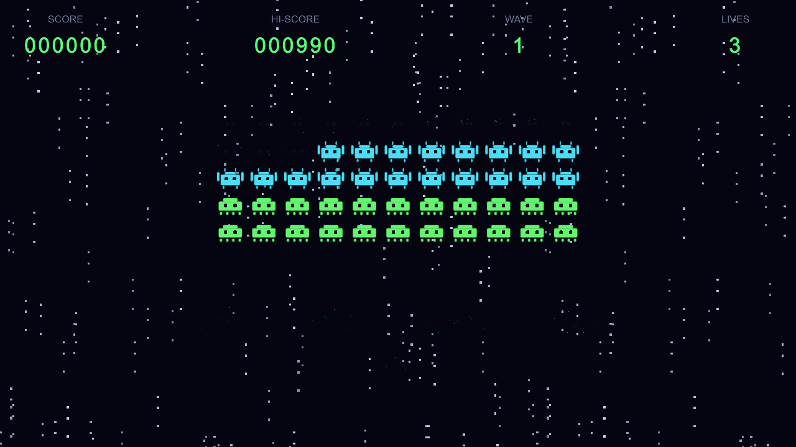
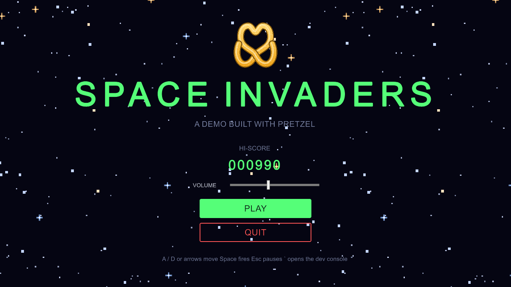
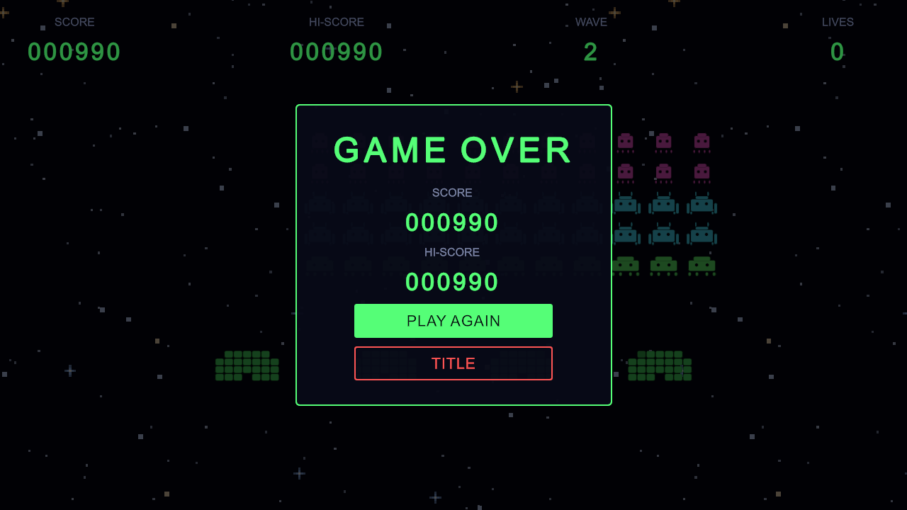
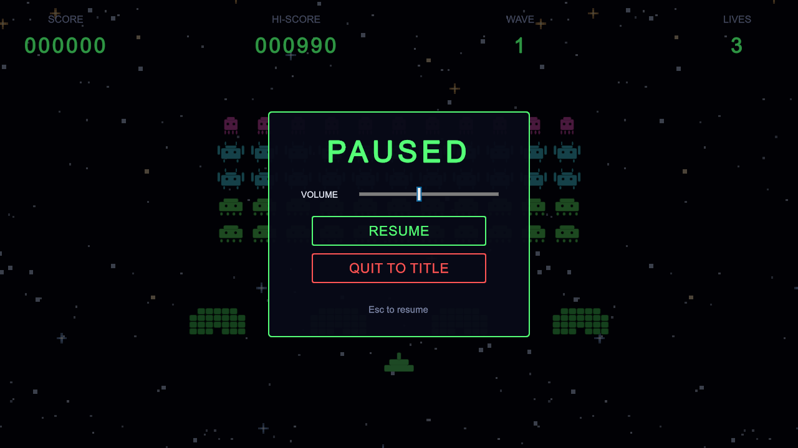
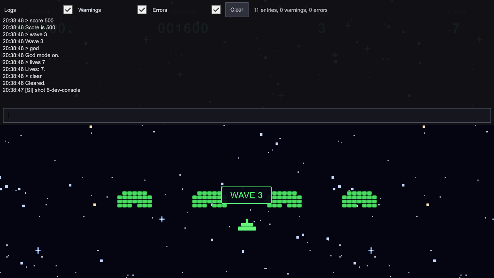

# Space Invaders: a Pretzel example

A complete, playable Space Invaders built on Pretzel. It is here to show how the modules fit together in a real game, not to be a package: clone the repository, open this folder in Unity and read the code.



| | |
|---|---|
| Unity | **6000.6.5f1**, created from the *Universal 2D* template, without Version Control and Visual Scripting |
| Render pipeline | URP 2D (Lit 2D renderer from the template; the game uses unlit sprites) |
| Art | Unity's built-in UI sprites (a rounded rectangle and a circle), tinted and composed into shapes, plus an eight-frame explosion and three star-field tiles drawn with Aseprite scripts (`Art~/`) |
| Sound | Ten WAV files made with SoundCraft scripts (`Art~/`): laser, hits, explosion, power-up, win and lose stingers, and the four march notes. Three 12-bar music loops (title, gameplay, last stand) come from `Art~/music.js` |
| Pretzel | The packages in this repository, referenced with `file:` paths in `Packages/manifest.json`. The game's code uses 18 of the 24: Setup, VContainer, Core, Events, Pooling, Scenes, UI, Audio, Sfx, Vfx, Cameras, Parallax, Inputs, Data, Preferences, DevConsole, Tween and Extensions. Api and Editor are referenced but not called, and Cloud, Multiplayer, UI (UGUI) and Integrations are not installed. [Where Pretzel is used](Documentation/PretzelUsage.md) covers all 24 |
| Other packages | VContainer 1.19.0 (from GitHub), Cinemachine 3.1.7, Input System, and the template defaults |

## Open it

1. In Unity Hub choose **Add > Add project from disk** and pick `Examples/SpaceInvaders`. Use Unity 6000.6.5f1.
2. The first open resolves packages and imports everything, so it takes a few minutes. It needs network access for VContainer, which comes from GitHub.
3. Open `Assets/_Project/Scenes/Title.unity` and press Play. `Game.unity` can also be played directly.

The Title and Game scenes are already in the build settings, and every asset is committed. Nothing needs generating before you play.

## Controls

| Action | Input |
|---|---|
| Move | A / D, arrow keys, gamepad stick |
| Fire | Space, Enter, left mouse button, gamepad south or west button |
| Pause | Esc, gamepad east button |
| Dev console | Back-quote (`` ` ``) |

The dev console commands are `god`, `score <n>`, `lives <n>`, `wave <n>`, `clear` and `ufo`.

## Game feel, from the newer modules

| Module | What you see |
|---|---|
| Vfx | A kill freezes the game for a few frames (hit stop). Losing a life adds a longer freeze, then slow motion, a red flash and a punch on the ship. Pausing is never undone by these effects |
| Cameras | A Cinemachine rig with `CameraShake` (a kill nudges, a hit shakes) and `PlayfieldFitter`, which keeps the whole 17.8 by 10 playfield visible on any window shape |
| Parallax | Three star layers (far, mid, near) that scroll by themselves. Every wave scrolls a little faster, and they stop when the game pauses |
| Sfx | Every sound is played by id through `ISfxPlayer` from a `SfxLibrary`, with throttling so a mass kill does not stack voices |
| Audio (music) | `TitleMusic` plays the title tune; `GameMusic` plays the gameplay loop, switches to the last stand from wave 5 and fades out when the game is lost. `IAudioService.PlayMusic` crossfades and loops |
| Inputs | One `InputRouter` owns the action maps. Pausing switches the context so the ship stops while the pause menu keeps working, and input is blocked while a scene loads |

The code for these lives in `Runtime/Feel/`, `Runtime/Audio/` and `Runtime/Composition/GameInput.cs`.

## Read it

| Document | What it covers |
|---|---|
| [Architecture](Documentation/Architecture.md) | Diagrams: modules, scopes and composition, the event bus, the scene flow, the game state machine |
| [Where Pretzel is used](Documentation/PretzelUsage.md) | All 24 Pretzel packages: a step-by-step trace of one shot through the modules, the exact files that use each module, the packages the game does not use and where they would plug in, and the plan for two players with Multiplayer |
| [Build it yourself](Documentation/BuildItYourself.md) | The order a new project would follow, the editor tools, running the tests and making a build |

A good reading order is the architecture diagrams, then `Composition/` and `Gameplay/Level/` for how things are wired, then the actors.

## Project layout

```
Assets/
  _Scripts/
    Runtime/            SpaceInvaders.Runtime asmdef
      Composition/      GameInstaller, GameFlow, services (generated by Pretzel Setup, then filled in)
      Gameplay/         Actors, Rules (plain C#), Messages (event payloads), Level (presenters)
      Audio/            GameSounds (ids), SoundBank (march and music clips), event-to-sound reactions, TitleMusic, GameMusic, master volume
      Feel/             GameFeelReactions: hit stop, slow motion, shake, flash, backdrop speed
      UI/               Views (UI Toolkit controllers) and presenters for the title and the HUD
    Editor/             SpaceInvaders.Editor asmdef: demo builder, art importer, wave inspector, sound library builder
    Tests/              EditMode (rules and reactions) and PlayMode (the real scenes) tests
  _Project/
    Scenes/ Prefabs/ ScriptableObjects/ Audio/ Art/ UI/ Settings/
Art~/                   Aseprite and SoundCraft sources and build scripts (ignored by Unity)
```

To remake the art or sound, edit the scripts in `Art~/` and run `build.ps1`, `build-audio.ps1` or `build-music.ps1` (Aseprite and SoundCraft must be installed), then use **Space Invaders > Build Demo**.

The folders come from Pretzel Setup's *Game* folder preset, with all scripts under `_Scripts` and everything else under `_Project`.

## Tests

- **EditMode (47):** the pure rules (march and tempo, scoring, waves, run state) and the reaction classes, including the music, tested against fakes for the sound player, shaker and time scale.
- **PlayMode (11):** plays the real scenes through the real composition root. A bullet kills an invader through the pool and physics, a wave is cleared, the player loses lives, the game ends and the high score saves, the game returns to the title, pause stops time, and the dev console drives the game. `FeelAndInputTests` covers hit stop and slow motion returning to normal, a pause surviving a hit, the playfield fit on three aspect ratios, the scrolling star field, the pause input context and input blocking during a scene load.

Both suites are described in [Build it yourself](Documentation/BuildItYourself.md#tests).

## Known limits

- It is built for Unity 6000.6.5f1 and has not been opened on other versions. The Pretzel packages themselves support Unity 6000.0 and newer.
- The playfield is 17.8 by 10 world units. `PlayfieldFitter` keeps all of it visible on any aspect ratio, so narrow windows show extra backdrop instead of cutting columns off.
- It is a single-player game. The Multiplayer package is not used; [Two players with Multiplayer](Documentation/PretzelUsage.md#two-players-with-multiplayer) describes what a co-op mode would change.
- There is no rebind screen. The input router, device tracker and scene-load gate are used, but `RebindSession` is not shown here; see the Inputs package sample.
- Keyboard, gamepad and mouse input and the sounds were checked in code and tests, not by hand, and the sounds were never listened to. The UI and the new art were checked through screenshots from the PlayMode tests.
- SpriteMancer was not used: it is a GUI-only tool with no command line, so the art was scripted with Aseprite instead.

## Screenshots

| Title | Game over |
|---|---|
|  |  |

| Pause | Dev console |
|---|---|
|  |  |
