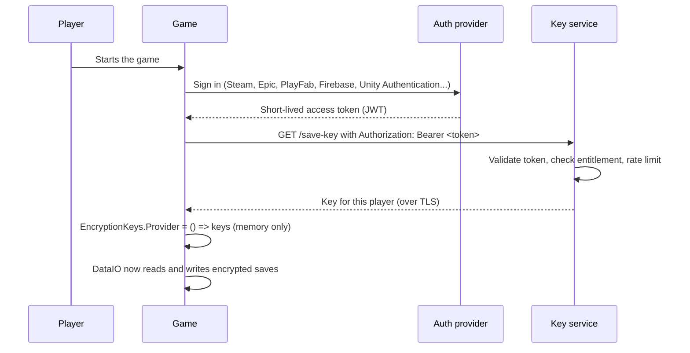

# Delivering encryption keys to a game

See also [EncryptionBestPractices.md](EncryptionBestPractices.md).

Pretzel's `Encrypted` format is only as strong as the way you handle its keys. This guide explains what each key is, where it can live, and how to give a shipped game access to a key without hard-coding it.

> A key that the game can use is a key the player's machine can reach. Anyone who can run the game and attach a debugger can get it. Everything below makes that harder or limits the damage. Nothing makes it impossible.

## The keys

| Key | Secret? | Used for | Where it may live |
|---|---|---|---|
| AES key (32 bytes) | Yes | Encrypts and decrypts in AES mode | Environment variable, project key file, a key service. Not in version control |
| RSA public key | No | Encrypts (writes) in RSA mode | Anywhere: project key file, environment variable, inside the game |
| RSA private key | Yes, always | Decrypts (reads) in RSA mode | Your server, a secret manager, your own machine. Never in the game or the repository |

The IV is not a key. Pretzel creates a random IV for every file and writes it into the file, so there is no IV to store, protect or ship.

## Where each key can be stored

- **Environment variables.** Names are `<PREFIX>_AES_KEY`, `<PREFIX>_RSA_PUBLIC` and `<PREFIX>_RSA_PRIVATE`. The values are Base64. The prefix is set per project in the Data Format window (default `PRETZEL_<PRODUCT>`). Variables belong to your user account on that machine, not to the project, so the prefix keeps projects apart. Good for development, build servers and dedicated servers.
- **Project key file.** `UserSettings/Pretzel/pretzel-keys.json` inside the project. It is per project and per user, and it is plain text. Keep `UserSettings` in `.gitignore`. Only the Editor reads it. Builds never do.
- **Public key only.** Because it is public, the RSA public key can also be put in the project key file, an environment variable, or compiled into the game.

## Three ways to get a key into a build

### 1. Environment variables on the machine running the game

Best for servers, tools and tests. Not practical for players. `DataIO` finds the variables by itself.

### 2. Embedded in the game (obfuscated)

The Shipping tab writes `PretzelDataSetup.cs`. It stores the AES key as two XOR-masked arrays and registers `EncryptionKeys.Provider` before the first scene loads.

This only defeats a string search of the build. A determined player can still recover the key. Use it when the aim is to stop casual save editing.

With RSA, embed the public key. That is safe by design, because the public key cannot decrypt anything.

### 3. Fetch the key with a token (recommended for secret keys)

The game does not contain the key. It asks a server for it after the player proves who they are.



Recommendations for the key service:

1. **Validate the token on the server.** Check signature, expiry, audience and that the player owns the game.
2. **Return a per-player key, not one shared key.** Derive it from a master secret that never leaves the server, for example `HKDF(masterSecret, info: userId)`. If one key leaks, it opens one player's saves.
3. **Keep the key in memory.** Do not write it to disk, PlayerPrefs or logs. Create the store after the key arrives.
4. **Use short lifetimes.** Tokens expire in minutes. Rotate keys by adding a key version to your service, and keep old versions until saves are re-saved.
5. **Rate limit and log** key requests, and revoke a player's token or key if it is abused.
6. **Use HTTPS only.** Consider certificate pinning for sensitive data.
7. **Plan for offline play.** Either require sign-in, or cache the key encrypted with the platform keystore (Windows DPAPI, Android Keystore, iOS Keychain) and accept the weaker guarantee.

Server side, in .NET:

```csharp
// masterSecret lives in Key Vault or your secret manager, never in the game.
byte[] playerKey = HKDF.DeriveKey(
    HashAlgorithmName.SHA256,
    masterSecret,
    outputLength: 32,
    salt: Encoding.UTF8.GetBytes("pretzel-save-v1"),
    info: Encoding.UTF8.GetBytes(userId));
return Convert.ToBase64String(playerKey);
```

Game side, using the generated `PretzelDataSetup`:

```csharp
// After sign-in succeeds:
bool ok = await PretzelDataSetup.LoadKeysAsync(accessToken);
if (!ok)
{
    // Offer offline play without saves, or ask the player to try again.
}
```

Open `PretzelDataSetup.cs` and fill in `RequestKeyAsync` with your own request (for example with `Pretzel.Api.ApiClient`).

## Protecting the private key

If you use RSA mode, the private key is the one that matters.

- Never ship it, commit it, or paste it into chat or a ticket.
- Keep it in a secret manager (Azure Key Vault, AWS Secrets Manager, HashiCorp Vault), a password manager, or an encrypted backup.
- Give your server access through its secret store or environment, not through a file in the repository.
- On a build server, use the CI system's secret variables.
- Decrypt on your server. If a tool needs to open files, use the Decrypt tab on a machine you trust.
- If it leaks, generate a new pair, ship the new public key, and re-encrypt the data you still need.

## Choosing a key size

RSA only wraps a random 32 byte AES key for each file, so the size mostly affects key generation time and 256 to 512 bytes of overhead per file.

| Size | Notes |
|---|---|
| 2048 | The minimum that is still acceptable. Smallest margin |
| 3072 | The 128-bit security level. A good balance |
| 4096 | **Recommended.** The largest margin, and key generation happens once |

The file encryption itself is always AES-256, whatever the RSA size.

## Checklist before you ship

- [ ] The AES key and RSA private key are not in the repository, the build or the logs.
- [ ] `UserSettings` is in `.gitignore`.
- [ ] You chose a delivery option above, and tested a fresh install.
- [ ] A save written by the previous build still opens (keep old keys until saves are re-saved).
- [ ] Wrong key and edited file both load as `Corrupt`, and the game handles that.
