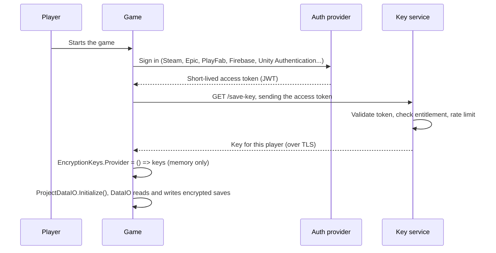

# Delivering encryption keys to a game

See also [EncryptionBestPractices.md](EncryptionBestPractices.md) and, for the whole setup, [DataIOSetup.md](DataIOSetup.md).

Pretzel's `Encrypted` format is only as strong as the way you handle its keys. This guide explains what each key is, where it can live, and how to give a shipped game access to a key without hard-coding it.

> A key that the game can use is a key the player's machine can reach. Anyone who can run the game and attach a debugger can get it, with or without IL2CPP. Everything below makes that harder or limits the damage. Nothing makes it impossible.

## The keys

| Key | Secret? | Used for | Where it may live |
|---|---|---|---|
| AES key (32 bytes) | Yes | Encrypts and decrypts in AES mode | Environment variable, project key file, a key service. Not in version control |
| RSA public key | No | Encrypts (writes) in RSA mode | Anywhere: project key file, environment variable, inside the game |
| RSA private key | Yes, always | Decrypts (reads) in RSA mode | Your server, a secret manager, your own machine. Never in the game or the repository |

The IV is not a key. Pretzel creates a random IV for every file and writes it into the file, so there is no IV to store, protect or ship.

## Choosing where the game reads its key

`DataIOConfig.keySource` (Keys tab) decides where `DataIO` looks. Pick the source your build ships, so a stray environment variable or Editor key file cannot hide a missing key:

| Key source | Reads |
|---|---|
| `Provider` | `EncryptionKeys.Provider` only: the embedded setup, a token flow, or your code |
| `BundledJson` | `Assets/Resources/Pretzel/GameEncryptionKeys.json` only |
| `Environment` | `<PREFIX>_AES_KEY`, `<PREFIX>_RSA_PUBLIC`, `<PREFIX>_RSA_PRIVATE` only. For servers and tools |
| `Automatic` | Provider, environment, the Editor key file, then the bundled JSON. For development |

The Setup tab, the Keys tab exports and the Shipping tab set the key source for you. The Keys tab shows which key is active and where it came from, by fingerprint. A build runs a check (Tools > Pretzel > DataIO > Check build setup) that fails when the chosen source would not give a player a key.

## Where each key can be stored

- **Environment variables.** Names are `<PREFIX>_AES_KEY`, `<PREFIX>_RSA_PUBLIC` and `<PREFIX>_RSA_PRIVATE`. The values are Base64. The prefix is set per project in the Data Format window (default `PRETZEL_<PRODUCT>`). Variables belong to your user account on that machine, not to the project, so the prefix keeps projects apart. They hold the current AES key only, not its history. Good for development, build servers and dedicated servers.
- **Project key file.** `UserSettings/Pretzel/pretzel-keys.json` inside the project. It is per project and per user, and it is plain text. Keep `UserSettings` in `.gitignore`. Only the Editor reads it. Builds never do. It also keeps the previous AES keys.
- **Game key config.** `Assets/Resources/Pretzel/GameEncryptionKeys.json`, written by the Setup button or the Keys tab. Unity includes it as a TextAsset in builds. It contains only the selected mode's AES key (with a `keyId` fingerprint and any `previousAesKeys`) or RSA public key, never the private key. A malformed config throws instead of being ignored.
- **Public key only.** Because it is public, the RSA public key can also be put in the project key file, an environment variable, the game key config, or compiled into the game.

## Four ways to get a key into a build

### 1. Environment variables on the machine running the game

Best for servers, tools and tests. Not practical for players. Set the key source to `Environment`.

### 2. Bundled JSON config (simple offline setup)

Use the Setup tab (**Generate AES / RSA encryption setup**, delivery *Bundled JSON*), or **Keys > Game-specific keys > Save game key config (JSON)**. The key source becomes `BundledJson`. No startup code is needed for the key. AES allows both reading and writing offline; RSA exports only the public key, so the game can write but your server must decrypt.

The config is plain text, not a secret store. Exclude it and its `.meta` from version control when it contains an AES key. Keep backups separately. Restart Play mode after exporting; an existing store keeps its keys. A new key does not change what an old save needs: the old key stays as a previous key.

### 3. Embedded in the game (obfuscated)

Use the Setup tab (delivery *Embedded C#*), the Shipping tab, or **Keys > Game-specific keys > Generate embedded C# setup**. It writes `PretzelDataSetup.cs`, which stores each AES key as two XOR-masked arrays and registers `EncryptionKeys.Provider` before the first scene loads. The key source becomes `Provider`.

This only defeats a string search of the build. IL2CPP compiles it to native code, which makes it less convenient to read but not secret. A determined player can still recover the key. Use it when the aim is to stop casual save editing. Keep the generated AES script out of version control.

With the key source set, only one of JSON and embedded C# is read. A JSON you no longer use still ships, so delete it; the build check warns about it.

With RSA, embed the public key. That is safe by design, because the public key cannot decrypt anything.

### 4. Fetch the key with a token (recommended for secret keys)

The game does not contain the key. It asks a server for it after the player proves who they are.



Recommendations for the key service:

1. **Validate the token on the server.** Check signature, expiry, audience and that the player owns the game.
2. **Return a per-player key, not one shared key.** Derive it from a master secret that never leaves the server, for example `HKDF(masterSecret, info: userId)`. If one key leaks, it opens one player's saves.
3. **Keep the key in memory.** Do not write it to disk, PlayerPrefs or logs. Create the store after the key arrives.
4. **Use short lifetimes.** Tokens expire in minutes. Rotate keys by adding a key version to your service, and keep old versions until saves are re-saved.
5. **Rate limit and log** key requests, and revoke a player's token or key if it is abused.
6. **Use HTTPS only.** Consider certificate pinning for sensitive data.
7. **Plan for offline play.** Either require sign-in, or cache the key encrypted with the platform keystore (Windows DPAPI, Android Keystore, iOS Keychain) and accept the weaker guarantee.

Server side, in .NET:

```csharp
// masterSecret lives in Key Vault or your secret manager, never in the game.
byte[] playerKey = HKDF.DeriveKey(
    HashAlgorithmName.SHA256,
    masterSecret,
    outputLength: 32,
    salt: Encoding.UTF8.GetBytes("pretzel-save-v1"),
    info: Encoding.UTF8.GetBytes(userId));
return Convert.ToBase64String(playerKey);
```

Game side, with the key source set to `Provider` and the generated token `PretzelDataSetup` (Shipping tab, *Fetch with a token*):

```csharp
// After sign-in succeeds:
if (!await PretzelDataSetup.LoadKeysAsync(accessToken))
{
    // Offer offline play without saves, or ask the player to try again.
    return;
}

ProjectDataIO.Initialize();   // creates the store with the key that just arrived
```

Or fetch the key yourself and pass it in: `ProjectDataIO.InitializeWithKeys(new EncryptionKeys { AesKey = key })`. Open `PretzelDataSetup.cs` and fill in `RequestKeyAsync` with your own request (for example with `Pretzel.Api.ApiClient`).

## Changing an AES key

Generate a new AES key on the Encryption tab. The old key is kept as a previous key:

- the key file, the bundled JSON (`previousAesKeys`) and the embedded setup all carry the history,
- saves written with an older key still open, and new files use the current key, so old files move to it as they are saved again,
- environment variables and a token flow carry the current key only, so supply the history yourself (`EncryptionKeys.PreviousAesKeys`) when a player may still hold older saves.

When every old save was loaded and saved again, use **Clear previous AES keys** on the Keys tab and export again, so builds stop carrying old keys. Keep a separate backup of every key your players' saves still need.

## Protecting the private key

If you use RSA mode, the private key is the one that matters.

- Never ship it, commit it, or paste it into chat or a ticket.
- Keep it in a secret manager (Azure Key Vault, AWS Secrets Manager, HashiCorp Vault), a password manager, or an encrypted backup.
- Give your server access through its secret store or environment, not through a file in the repository.
- On a build server, use the CI system's secret variables.
- Decrypt on your server (`ProjectDataIO.CreateServerStore` in an RSA setup). If a tool needs to open files, use the Decrypt tab on a machine you trust.
- If it leaks, generate a new pair, ship the new public key, and re-encrypt the data you still need.

`ProjectDataIO` gives a game client only what it needs: `EncryptionKeys.ForClient` drops the private key, and `Describe()` warns if one was loaded.

## Choosing a key size

RSA only wraps a random 32 byte AES key for each file, so the size mostly affects key generation time and 256 to 512 bytes of overhead per file.

| Size | Notes |
|---|---|
| 2048 | The minimum that is still acceptable. Smallest margin |
| 3072 | The 128-bit security level. A good balance |
| 4096 | **Recommended.** The largest margin, and key generation happens once |

The file encryption itself is always AES-256, whatever the RSA size.

## Checklist before you ship

- [ ] The RSA private key is not in the repository, the build or the logs. The AES key is not in the repository or logs; if bundled for offline saves, its extractability is an accepted trade-off.
- [ ] `UserSettings` is in `.gitignore`.
- [ ] The key source matches your delivery, and **Check build setup** is clean.
- [ ] You tested a build without the Editor key file or your environment variables.
- [ ] A save written by the previous build still opens (keep old keys as previous keys until saves are re-saved).
- [ ] Wrong key and edited file both load as `Corrupt`, and the game handles that.
