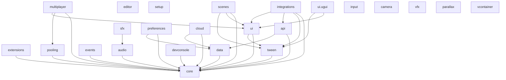

# Pretzel

A modular set of Unity packages, the successor to LazyJedi. Every package is `com.uee03.pretzel.*`, with assemblies named `Pretzel.<Module>`.

Start with [setup](Packages/com.uee03.pretzel.setup/README.md). It is the only package you install by hand: it needs no other Pretzel module, and its Addons tab installs the rest.

Requires Unity 6000.0 or newer (nothing older is supported). Local Editor validation uses 6000.0.85f1 and 6000.6.5f1; see
[compatibility and release gates](COMPATIBILITY.md) for the exact tested scope and unverified targets.

## Modules



| Package | What it does |
|---|---|
| [setup](Packages/com.uee03.pretzel.setup/README.md) | Install this first. Project Setup window, Addons tabs, scene templates. No other Pretzel module needed |
| [core](Packages/com.uee03.pretzel.core/README.md) | `Guard`, singletons, timers and cooldowns |
| [extensions](Packages/com.uee03.pretzel.extensions/README.md) | Extension methods for .NET and Unity types |
| [data](Packages/com.uee03.pretzel.data/README.md) | Save and load with pluggable serializers and formats, save slots, auto-save, `SerializableGuid`, and the Data Format window. Has the LazyJedi migration table |
| [tween](Packages/com.uee03.pretzel.tween/README.md) | Easing functions |
| [ui](Packages/com.uee03.pretzel.ui/README.md) | UI Toolkit helpers: fades, screen navigation, toasts, safe area, world-space helpers, controller base, Editor UI building blocks |
| [ui.ugui](Packages/com.uee03.pretzel.ui.ugui/README.md) | UGUI `UIFader`, hover fade, extensions |
| [api](Packages/com.uee03.pretzel.api/README.md) | HTTP client on `Awaitable` |
| [events](Packages/com.uee03.pretzel.events/README.md) | Typed event bus and ScriptableObject event channels |
| [pooling](Packages/com.uee03.pretzel.pooling/README.md) | Prefab pools with prewarming and reset hooks |
| [scenes](Packages/com.uee03.pretzel.scenes/README.md) | Scene loading with groups, preloading, request queuing, observable state, setup phases, transitions and fallback |
| [audio](Packages/com.uee03.pretzel.audio/README.md) | Audio service with pooled voices, cues, mixer channels and music crossfades |
| [sfx](Packages/com.uee03.pretzel.sfx/README.md) | Sound effects by name on top of Audio: an `SfxLibrary` asset, a player with per-sound cooldowns and voice limits, and a pack of thirteen generated game sounds |
| [preferences](Packages/com.uee03.pretzel.preferences/README.md) | Saved player preferences for audio, graphics, controls and language |
| [devconsole](Packages/com.uee03.pretzel.devconsole/README.md) | In-game log overlay and command console for development builds |
| [cloud](Packages/com.uee03.pretzel.cloud/README.md) | Unity Gaming Services behind interfaces: Authentication, Cloud Save, Cloud Code, Remote Config, and an offline-first cloud save store for Pretzel Data. Adapters compile only when the Unity package is installed |
| [multiplayer](Packages/com.uee03.pretzel.multiplayer/README.md) | Netcode for GameObjects + Multiplayer Services (Sessions/Relay): local couch co-op, online, cross-play tagging, rejoin, pooled spawns, a drop-in UI Toolkit menu and a two-cube sample |
| [input](Packages/com.uee03.pretzel.input/README.md) | Input System tools: a context stack that enables one action map at a time, input blocked for named reasons (scene loads), input buffering, device tracking, a safe rebind and saved overrides. Optional Preferences and Scenes adapters |
| [camera](Packages/com.uee03.pretzel.camera/README.md) | Cinemachine 3 tools for 2D, 2.5D and 3D: trauma-based screen shake, a playfield fit for every aspect ratio, and ready camera rigs from the GameObject menu. Needs no other Pretzel module |
| [vfx](Packages/com.uee03.pretzel.vfx/README.md) | Game feel: hit stop and slow motion on a safe time-scale stack that cooperates with a pause, sprite flash and punch scale. Needs no other Pretzel module |
| [parallax](Packages/com.uee03.pretzel.parallax/README.md) | Parallax scrolling for 2D and 2.5D: per-axis factor or depth, endless tiling, pixel snapping, one allocation-free update. Works with any camera, including Cinemachine. Needs no other Pretzel module |
| [vcontainer](Packages/com.uee03.pretzel.vcontainer/README.md) | VContainer scopes and installers (`PretzelLifetimeScope`, `ScriptableInstaller`, `MonoInstaller`). Needs no other Pretzel module. Optional: every module also works [without a container](Packages/com.uee03.pretzel.setup/Documentation~/WithoutAContainer.md) |
| [integrations](Packages/com.uee03.pretzel.integrations/README.md) | Adapters for LitMotion (ease mapping), UniTask (`ApiClient` calls) and R3 (UI Toolkit and `ApiClient` observables) |
| [editor](Packages/com.uee03.pretzel.editor/README.md) | Standalone editor utilities that work in any project |

The list runs from the base layer to optional extras, and the Addons tab uses the same order. The tab reads a catalog
generated from these manifests by `.github/scripts/Update-ModuleCatalog.ps1`; run it after changing a `package.json`.

Each integration assembly compiles only when its third-party package is installed. Their `versionDefines` switch the assembly on, so having them without the third-party package is harmless.

## Example

[`Examples/SpaceInvaders`](Examples/SpaceInvaders/README.md) is a complete game built on Pretzel, as a Unity project you can open (Unity 6000.6.5f1, Universal 2D template). It plays alone or as two-player co-op, local or online. Its code uses 19 of the 24 packages. It comes with architecture diagrams, [a guide that traces one shot through the modules and covers all 24 packages](Examples/SpaceInvaders/Documentation/PretzelUsage.md), and a build-it-yourself walkthrough.

## Using the packages

The packages live in `Packages/`. `TestPretzel/` is a Unity project for trying them out. To use Pretzel in a project, add `com.uee03.pretzel.setup` to its `manifest.json` as a git dependency (`https://github.com/Uee03/Pretzel.git?path=Packages/com.uee03.pretzel.setup#v0.2.0`), then install the other modules from the Addons tab. The tab installs them from the same repository and tag that Setup came from, unless the Settings tab overrides it.

### Git URLs

In Unity, open `Window > Package Manager`, choose `+ > Install package from git URL...` and paste the URL of the package. Append `#<tag>` (for example `#v0.2.0`) to pin a version, or `#main` for the latest commit.

| Package | Git URL |
|---|---|
| setup | `https://github.com/Uee03/Pretzel.git?path=Packages/com.uee03.pretzel.setup` |
| core | `https://github.com/Uee03/Pretzel.git?path=Packages/com.uee03.pretzel.core` |
| extensions | `https://github.com/Uee03/Pretzel.git?path=Packages/com.uee03.pretzel.extensions` |
| data | `https://github.com/Uee03/Pretzel.git?path=Packages/com.uee03.pretzel.data` |
| tween | `https://github.com/Uee03/Pretzel.git?path=Packages/com.uee03.pretzel.tween` |
| ui | `https://github.com/Uee03/Pretzel.git?path=Packages/com.uee03.pretzel.ui` |
| ui.ugui | `https://github.com/Uee03/Pretzel.git?path=Packages/com.uee03.pretzel.ui.ugui` |
| api | `https://github.com/Uee03/Pretzel.git?path=Packages/com.uee03.pretzel.api` |
| events | `https://github.com/Uee03/Pretzel.git?path=Packages/com.uee03.pretzel.events` |
| pooling | `https://github.com/Uee03/Pretzel.git?path=Packages/com.uee03.pretzel.pooling` |
| scenes | `https://github.com/Uee03/Pretzel.git?path=Packages/com.uee03.pretzel.scenes` |
| audio | `https://github.com/Uee03/Pretzel.git?path=Packages/com.uee03.pretzel.audio` |
| sfx | `https://github.com/Uee03/Pretzel.git?path=Packages/com.uee03.pretzel.sfx` |
| preferences | `https://github.com/Uee03/Pretzel.git?path=Packages/com.uee03.pretzel.preferences` |
| devconsole | `https://github.com/Uee03/Pretzel.git?path=Packages/com.uee03.pretzel.devconsole` |
| cloud | `https://github.com/Uee03/Pretzel.git?path=Packages/com.uee03.pretzel.cloud` |
| multiplayer | `https://github.com/Uee03/Pretzel.git?path=Packages/com.uee03.pretzel.multiplayer` |
| input | `https://github.com/Uee03/Pretzel.git?path=Packages/com.uee03.pretzel.input` |
| camera | `https://github.com/Uee03/Pretzel.git?path=Packages/com.uee03.pretzel.camera` |
| vfx | `https://github.com/Uee03/Pretzel.git?path=Packages/com.uee03.pretzel.vfx` |
| parallax | `https://github.com/Uee03/Pretzel.git?path=Packages/com.uee03.pretzel.parallax` |
| vcontainer | `https://github.com/Uee03/Pretzel.git?path=Packages/com.uee03.pretzel.vcontainer` |
| integrations | `https://github.com/Uee03/Pretzel.git?path=Packages/com.uee03.pretzel.integrations` |
| editor | `https://github.com/Uee03/Pretzel.git?path=Packages/com.uee03.pretzel.editor` |

Or add them to `manifest.json`:

```json
{
  "dependencies": {
    "com.uee03.pretzel.setup": "https://github.com/Uee03/Pretzel.git?path=Packages/com.uee03.pretzel.setup"
  }
}
```

Open `Pretzel > Project Setup` to create the folder structure, start a 2D or 3D scene, and install the recommended addons.

## Moving from LazyJedi

LazyJedi stays as it is and is deprecated once Pretzel ships. The renames are listed in the READMEs of [data](Packages/com.uee03.pretzel.data/README.md) and [extensions](Packages/com.uee03.pretzel.extensions/README.md).

## Samples

Every module ships runnable samples under its `Samples~` folder, and they are all in this repository, so you can read
them on GitHub without installing anything. The list below is generated from each package's `package.json`; it updates
itself when a sample is added or removed (see below).

**How to get a sample into your project**

1. Install the package (Git URL or the Setup window's Addons tab).
2. Open `Window > Package Manager`, select the package under **In Project**, open its **Samples** section and press
   **Import**. Unity copies the sample into `Assets/Samples/<Package>/<Version>/<Sample>/`.
3. Read the sample's `README.md` for the 2-3 steps to try it. Most samples build their scenes in code, so they run on an
   empty GameObject; the multiplayer sample generates its scene from a menu item.

There is no separate samples project on purpose: samples are versioned with the package they demonstrate, so an imported
sample always matches the API you installed. `TestPretzel/` is the consumer project used to validate them.

**Sample list**

<!-- SAMPLES:START -->
<!-- Generated by .github/scripts/Update-SampleCatalog.ps1 from each package.json. Do not edit by hand. -->

38 samples in 24 packages.

| Package | Sample | What it shows | Source |
|---|---|---|---|
| [api](Packages/com.uee03.pretzel.api/README.md) | **API Usage** | Every request type (JSON, text, bytes, HEAD, file, texture and audio downloads), options, retries, errors and cancellation. | [Samples~/ApiUsage](Packages/com.uee03.pretzel.api/Samples~/ApiUsage) |
| [audio](Packages/com.uee03.pretzel.audio/README.md) | **Audio Usage** | Plays cues, crossfades music and binds channel volumes to sliders. | [Samples~/AudioUsage](Packages/com.uee03.pretzel.audio/Samples~/AudioUsage) |
| [camera](Packages/com.uee03.pretzel.camera/README.md) | **Camera Example** | A 2D arena with a Cinemachine follow camera, trauma shake on click and a playfield that fits every aspect ratio. | [Samples~/CameraExample](Packages/com.uee03.pretzel.camera/Samples~/CameraExample) |
| [cloud](Packages/com.uee03.pretzel.cloud/README.md) | **Cloud Save Usage** | Signs in anonymously and saves and loads a profile through the offline-first synced store, with a sync status label. Needs the Authentication and Cloud Save packages. | [Samples~/CloudSaveUsage](Packages/com.uee03.pretzel.cloud/Samples~/CloudSaveUsage) |
|  | **Cloud Code And Remote Config** | Calls a Cloud Code module endpoint and reads Remote Config values with typed defaults. Needs the Authentication, Cloud Code and Remote Config packages. | [Samples~/CloudCodeAndRemoteConfig](Packages/com.uee03.pretzel.cloud/Samples~/CloudCodeAndRemoteConfig) |
|  | **Manual Wiring With Fakes** | Uses the cloud interfaces with in-memory fakes and a temp-folder local store, so a game runs and tests offline without any Unity Gaming Services package. | [Samples~/ManualWiringWithFakes](Packages/com.uee03.pretzel.cloud/Samples~/ManualWiringWithFakes) |
| [core](Packages/com.uee03.pretzel.core/README.md) | **Core Usage** | Singletons and argument guards. | [Samples~/CoreUsage](Packages/com.uee03.pretzel.core/Samples~/CoreUsage) |
| [data](Packages/com.uee03.pretzel.data/README.md) | **Data Usage** | Keys, slots, GUIDs, JSON helpers, interface fields, ScriptableObjects, migrations, async saves, transforms and AES save/load. | [Samples~/DataUsage](Packages/com.uee03.pretzel.data/Samples~/DataUsage) |
| [devconsole](Packages/com.uee03.pretzel.devconsole/README.md) | **Dev Console Usage** | A playable arena where console commands (god, heal, spawn, gold, tp, set/get tuning, timescale) change real game state. | [Samples~/DevConsoleUsage](Packages/com.uee03.pretzel.devconsole/Samples~/DevConsoleUsage) |
| [editor](Packages/com.uee03.pretzel.editor/README.md) | **Editor Usage** | Builds a demo hierarchy and groups it with Group Selected Objects, with undo. | [Samples~/EditorUsage](Packages/com.uee03.pretzel.editor/Samples~/EditorUsage) |
| [events](Packages/com.uee03.pretzel.events/README.md) | **Events Usage** | An EventBus publisher and subscriber, and a ScriptableObject channel raised from code. | [Samples~/EventsUsage](Packages/com.uee03.pretzel.events/Samples~/EventsUsage) |
| [extensions](Packages/com.uee03.pretzel.extensions/README.md) | **Extensions Usage** | Every extension: strings, bytes, collections, floats, objects, layer masks, Transform, GameObject, MonoBehaviour, Texture2D and file IO. | [Samples~/ExtensionsUsage](Packages/com.uee03.pretzel.extensions/Samples~/ExtensionsUsage) |
| [input](Packages/com.uee03.pretzel.input/README.md) | **Input Example** | A character moved through a Gameplay context, a pause that switches contexts, a buffered jump, device tracking and a rebind button with saved overrides. | [Samples~/InputExample](Packages/com.uee03.pretzel.input/Samples~/InputExample) |
| [integrations](Packages/com.uee03.pretzel.integrations/README.md) | **Integrations Example** | One demo per library (LitMotion, UniTask, R3), one for R3 with Pretzel Events, and one that combines LitMotion, UniTask and R3. | [Samples~/IntegrationsExample](Packages/com.uee03.pretzel.integrations/Samples~/IntegrationsExample) |
| [multiplayer](Packages/com.uee03.pretzel.multiplayer/README.md) | **Two Cubes** | Two networked cubes that can only move, jump and turn, plus Spawn Item and Delete Items buttons that use the pooled spawn handler. Works in local co-op, online host/join and quick-join through the drop-in menu. Create the scene with Pretzel > Samples > Multiplayer. | [Samples~/TwoCubes](Packages/com.uee03.pretzel.multiplayer/Samples~/TwoCubes) |
| [parallax](Packages/com.uee03.pretzel.parallax/README.md) | **Parallax Example** | A side-scrolling backdrop with five layers: a 2D scene with an orthographic camera and a 2.5D scene with depth, both with infinitely tiling layers. | [Samples~/ParallaxExample](Packages/com.uee03.pretzel.parallax/Samples~/ParallaxExample) |
| [pooling](Packages/com.uee03.pretzel.pooling/README.md) | **Pooling Usage** | An enum-keyed projectile factory configured in the Inspector, with prewarming and projectiles that release themselves after a delay. | [Samples~/PoolingUsage](Packages/com.uee03.pretzel.pooling/Samples~/PoolingUsage) |
|  | **Enemy Waves** | A wave spawner on a keyed PoolFactory: prewarm sizing, a cap on live enemies, return callbacks and live pool metrics. | [Samples~/EnemyWaves](Packages/com.uee03.pretzel.pooling/Samples~/EnemyWaves) |
|  | **Bullets And Impacts** | A turret with pooled bullets that spawn pooled impact effects through a small interface, on PoolRegistry and ComponentPool. | [Samples~/BulletsAndImpacts](Packages/com.uee03.pretzel.pooling/Samples~/BulletsAndImpacts) |
|  | **Floating Text** | Pooled UI Toolkit labels for damage numbers using UnityEngine.Pool.ObjectPool, animated without layout passes. | [Samples~/FloatingText](Packages/com.uee03.pretzel.pooling/Samples~/FloatingText) |
| [preferences](Packages/com.uee03.pretzel.preferences/README.md) | **Preferences Usage** | Loads preferences at startup, applies graphics and forwards audio volumes to an AudioMixer. | [Samples~/PreferencesUsage](Packages/com.uee03.pretzel.preferences/Samples~/PreferencesUsage) |
|  | **Custom Preferences Service** | Implements IPreferencesService on PlayerPrefs and in memory, and swaps backends from one composition root. | [Samples~/CustomPreferencesService](Packages/com.uee03.pretzel.preferences/Samples~/CustomPreferencesService) |
|  | **Options Menu** | A runtime UI Toolkit options screen with an Apply/Revert draft and appliers for audio, graphics and language. | [Samples~/OptionsMenu](Packages/com.uee03.pretzel.preferences/Samples~/OptionsMenu) |
| [scenes](Packages/com.uee03.pretzel.scenes/README.md) | **Scenes Usage** | A loading screen with UIDocumentSceneTransition and a menu that loads scenes additively or as a single scene. | [Samples~/ScenesUsage](Packages/com.uee03.pretzel.scenes/Samples~/ScenesUsage) |
|  | **Level Loading** | Additive levels loaded behind a loading screen whose progress bar also covers spawning pooled enemies from placed markers. Needs Pretzel Pooling. | [Samples~/LevelLoading](Packages/com.uee03.pretzel.scenes/Samples~/LevelLoading) |
| [setup](Packages/com.uee03.pretzel.setup/README.md) | **Setup Extensions** | Add your own Project Setup tab and Main tab section with IPretzelTab and IPretzelMainSection. | [Samples~/SetupExtensions](Packages/com.uee03.pretzel.setup/Samples~/SetupExtensions) |
|  | **No Container** | Click Rush: a complete small game with no DI container. Services live in a ScriptableObject filled by a bootstrap, with Events, Scenes, Data and Preferences, UI Toolkit screens, tests and scene builder. | [Samples~/NoContainer](Packages/com.uee03.pretzel.setup/Samples~/NoContainer) |
| [sfx](Packages/com.uee03.pretzel.sfx/README.md) | **SFX Pack** | Thirteen generated sounds (UI, pickups, hits, explosion, stingers) wired into an SfxLibrary, with a sound board scene. | [Samples~/SfxPack](Packages/com.uee03.pretzel.sfx/Samples~/SfxPack) |
| [tween](Packages/com.uee03.pretzel.tween/README.md) | **Tween Usage** | Ease types and AnimationCurve lerps for float, Vector2, Vector3 and Color, plus Evaluate. | [Samples~/TweenUsage](Packages/com.uee03.pretzel.tween/Samples~/TweenUsage) |
| [ui](Packages/com.uee03.pretzel.ui/README.md) | **UI Toolkit Usage** | Two screens with UIControllerBase, every element factory, fades, UIHoverFade, UIDocumentFader and an Editor window for the Editor-only factories. | [Samples~/UIUsage](Packages/com.uee03.pretzel.ui/Samples~/UIUsage) |
|  | **Game UI Helpers** | Screen navigation with UIScreenStack, a modal dialog, toasts, a safe-area root and a name tag that follows a 3D object. | [Samples~/GameUIHelpers](Packages/com.uee03.pretzel.ui/Samples~/GameUIHelpers) |
|  | **Editor UI Helpers** | An editor window and a custom inspector built with EditorUI and InspectorBase. | [Samples~/EditorUIHelpers](Packages/com.uee03.pretzel.ui/Samples~/EditorUIHelpers) |
|  | **Editor Windows** | UI Toolkit EditorWindows by topic: basics, group boxes, lists, tabs, tables with data and a combined dashboard. | [Samples~/EditorWindows](Packages/com.uee03.pretzel.ui/Samples~/EditorWindows) |
|  | **Custom Inspectors** | Custom editors with CreateInspectorGUI: the default layout plus extra buttons, fully custom layouts, components, ScriptableObjects and multi-object editing. | [Samples~/CustomInspectors](Packages/com.uee03.pretzel.ui/Samples~/CustomInspectors) |
|  | **Property Drawers** | Property drawers in three levels of complexity: basic, intermediate (rows, min/max, ShowIf) and advanced (lists, data-source dropdowns, SerializeReference). | [Samples~/PropertyDrawers](Packages/com.uee03.pretzel.ui/Samples~/PropertyDrawers) |
| [ui.ugui](Packages/com.uee03.pretzel.ui.ugui/README.md) | **UGUI Usage** | UIFader on a CanvasGroup, OnMouseHoverFade, and the Button and placeholder extensions. | [Samples~/UGUIUsage](Packages/com.uee03.pretzel.ui.ugui/Samples~/UGUIUsage) |
| [vcontainer](Packages/com.uee03.pretzel.vcontainer/README.md) | **VContainer Example** | Every VContainer feature in one scene with one LifetimeScope, one folder per feature: registration, lifetimes, injection, entry points, tickable timers and bullets, factories, components, collections, keys, open generics, settings, installers, callbacks and child scopes. | [Samples~/VContainerExample](Packages/com.uee03.pretzel.vcontainer/Samples~/VContainerExample) |
| [vfx](Packages/com.uee03.pretzel.vfx/README.md) | **Game Feel Example** | A bouncing orb with buttons for hit stop, slow motion, flash and punch, alone and together. | [Samples~/GameFeelExample](Packages/com.uee03.pretzel.vfx/Samples~/GameFeelExample) |
<!-- SAMPLES:END -->

The list is maintained by [Update-SampleCatalog.ps1](.github/scripts/Update-SampleCatalog.ps1), which reads the `samples`
array of every `package.json` and fails if a listed folder is missing. After adding or removing a sample, run it, or
just commit: the pre-commit hook (`git config core.hooksPath .githooks`) regenerates and stages the list.
`Update-SampleCatalog.ps1 -Check` verifies it before a release.

## DataIO quick start

[Pretzel Data](Packages/com.uee03.pretzel.data/README.md) defaults to plain JSON with no key setup.
For binary or encrypted saves, open **Pretzel > Data Format > Setup** and generate the matching
startup. AES is the only encryption option. Use one backed-up AES key across
releases; rotation is an optional advanced feature. The independent examples cover editable JSON
settings, binary inventory and an AES profile.

Load results distinguish missing data from unreadable data. Handle both explicitly rather than
silently starting a new profile. The Setup tab includes isolated save/load diagnostics, a store-folder
action and limited build-delivery checks. A real player save/quit/relaunch test is still required.

## Validation

Validation runs locally. The [host preparation script](.github/scripts/New-UnityValidationHost.ps1)
creates a clean consumer project from the checkout with every package embedded and testable, without touching the open
`TestPretzel` project. Run the EditMode suite there in batch mode, and compile the samples and generated examples in a
second host. See [COMPATIBILITY.md](COMPATIBILITY.md) for the commands, the tested scope and the release checklist.

## License

MIT. See [LICENSE](LICENSE). Every package carries the same license in its `LICENSE.md`.
