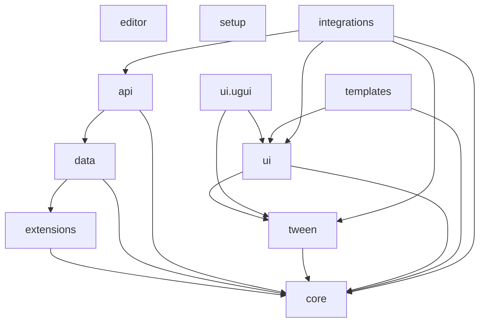

# Pretzel

A modular set of Unity packages, the successor to LazyJedi. Every package is `com.uee03.pretzel.*`, with assemblies named `Pretzel.<Module>`.

Start with [setup](Packages/com.uee03.pretzel.setup/README.md). It is the only package you install by hand: it needs no other Pretzel module, and its Addons tab installs the rest.

Requires Unity 6000.0 or newer. Tested on 6000.6.

## Modules



| Package | What it does |
|---|---|
| [setup](Packages/com.uee03.pretzel.setup/README.md) | Install this first. Project Setup window, Addons tabs, scene templates. No other Pretzel module needed |
| [core](Packages/com.uee03.pretzel.core/README.md) | `Guard` and singletons |
| [extensions](Packages/com.uee03.pretzel.extensions/README.md) | Extension methods for .NET and Unity types |
| [data](Packages/com.uee03.pretzel.data/README.md) | Save and load with pluggable serializers, `SerializableGuid`, and the Data Format window. Has the LazyJedi migration table |
| [tween](Packages/com.uee03.pretzel.tween/README.md) | Easing functions |
| [ui](Packages/com.uee03.pretzel.ui/README.md) | UI Toolkit helpers, fades, controller base |
| [ui.ugui](Packages/com.uee03.pretzel.ui.ugui/README.md) | UGUI `UIFader`, hover fade, extensions |
| [api](Packages/com.uee03.pretzel.api/README.md) | HTTP client on `Awaitable` |
| [templates](Packages/com.uee03.pretzel.templates/README.md) | Script templates |
| [integrations](Packages/com.uee03.pretzel.integrations/README.md) | Adapters for LitMotion (ease mapping), UniTask (`ApiClient` calls) and R3 (UI Toolkit and `ApiClient` observables) |
| [editor](Packages/com.uee03.pretzel.editor/README.md) | Standalone editor utilities that work in any project |

The list runs from the base layer to optional extras, and the Addons tab uses the same order.

Each integration assembly compiles only when its third-party package is installed. Their `versionDefines` switch the assembly on, so having them without the third-party package is harmless.

## Using the packages

The packages live in `Packages/`. `TestPretzel/` is a Unity project for trying them out. To use Pretzel in a project, add `com.uee03.pretzel.setup` to its `manifest.json` as a git dependency (`https://github.com/Uee03/Pretzel.git?path=Packages/com.uee03.pretzel.setup#<tag>`), then install the other modules from the Addons tab. The tab installs them from the same repository and tag that Setup came from, unless the Settings tab overrides it.

### Git URLs

In Unity, open `Window > Package Manager`, choose `+ > Install package from git URL...` and paste the URL of the package. Append `#<tag>` (or `#main`) to pin a version.

| Package | Git URL |
|---|---|
| setup | `https://github.com/Uee03/Pretzel.git?path=Packages/com.uee03.pretzel.setup` |
| core | `https://github.com/Uee03/Pretzel.git?path=Packages/com.uee03.pretzel.core` |
| extensions | `https://github.com/Uee03/Pretzel.git?path=Packages/com.uee03.pretzel.extensions` |
| data | `https://github.com/Uee03/Pretzel.git?path=Packages/com.uee03.pretzel.data` |
| tween | `https://github.com/Uee03/Pretzel.git?path=Packages/com.uee03.pretzel.tween` |
| ui | `https://github.com/Uee03/Pretzel.git?path=Packages/com.uee03.pretzel.ui` |
| ui.ugui | `https://github.com/Uee03/Pretzel.git?path=Packages/com.uee03.pretzel.ui.ugui` |
| api | `https://github.com/Uee03/Pretzel.git?path=Packages/com.uee03.pretzel.api` |
| templates | `https://github.com/Uee03/Pretzel.git?path=Packages/com.uee03.pretzel.templates` |
| integrations | `https://github.com/Uee03/Pretzel.git?path=Packages/com.uee03.pretzel.integrations` |
| editor | `https://github.com/Uee03/Pretzel.git?path=Packages/com.uee03.pretzel.editor` |

Or add them to `manifest.json`:

```json
{
  "dependencies": {
    "com.uee03.pretzel.setup": "https://github.com/Uee03/Pretzel.git?path=Packages/com.uee03.pretzel.setup"
  }
}
```

Open `Pretzel > Project Setup` to create the folder structure, start a 2D or 3D scene, and install the recommended addons.

## Moving from LazyJedi

LazyJedi stays as it is and is deprecated once Pretzel ships. The renames are listed in the READMEs of [data](Packages/com.uee03.pretzel.data/README.md) and [extensions](Packages/com.uee03.pretzel.extensions/README.md).

## Samples

Each module has a code sample under its `Samples~` folder. Import it from the Package Manager window.
