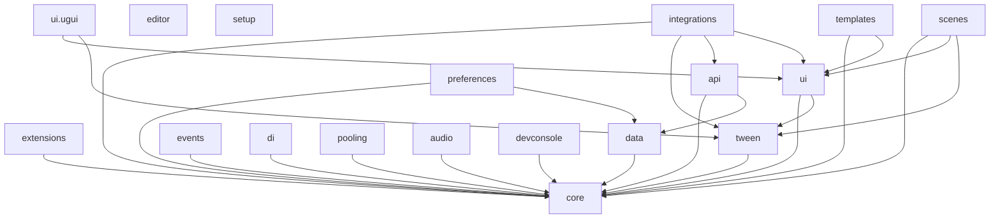

# Pretzel

A modular set of Unity packages, the successor to LazyJedi. Every package is `com.uee03.pretzel.*`, with assemblies named `Pretzel.<Module>`.

Start with [setup](Packages/com.uee03.pretzel.setup/README.md). It is the only package you install by hand: it needs no other Pretzel module, and its Addons tab installs the rest.

Requires Unity 6000.0 or newer. Local Editor validation uses 6000.6.5f1; see
[compatibility and release gates](COMPATIBILITY.md) for the exact tested scope and unverified targets.

## Modules



| Package | What it does |
|---|---|
| [setup](Packages/com.uee03.pretzel.setup/README.md) | Install this first. Project Setup window, Addons tabs, scene templates. No other Pretzel module needed |
| [core](Packages/com.uee03.pretzel.core/README.md) | `Guard`, singletons, timers and cooldowns |
| [extensions](Packages/com.uee03.pretzel.extensions/README.md) | Extension methods for .NET and Unity types |
| [data](Packages/com.uee03.pretzel.data/README.md) | Save and load with pluggable serializers and formats, save slots, auto-save, `SerializableGuid`, and the Data Format window. Has the LazyJedi migration table |
| [tween](Packages/com.uee03.pretzel.tween/README.md) | Easing functions |
| [ui](Packages/com.uee03.pretzel.ui/README.md) | UI Toolkit helpers: fades, screen navigation, toasts, safe area, world-space helpers, controller base, Editor UI building blocks |
| [ui.ugui](Packages/com.uee03.pretzel.ui.ugui/README.md) | UGUI `UIFader`, hover fade, extensions |
| [api](Packages/com.uee03.pretzel.api/README.md) | HTTP client on `Awaitable` |
| [events](Packages/com.uee03.pretzel.events/README.md) | Typed event bus and ScriptableObject event channels |
| [di](Packages/com.uee03.pretzel.di/README.md) | Dependency injection container with lifetimes, scopes, entry points and a `LifetimeScope` component |
| [pooling](Packages/com.uee03.pretzel.pooling/README.md) | Prefab pools with prewarming and reset hooks |
| [scenes](Packages/com.uee03.pretzel.scenes/README.md) | Gated scene loading with transitions, progress and cancellation |
| [audio](Packages/com.uee03.pretzel.audio/README.md) | Audio manager with pooled voices, cues, mixer channels and music crossfades |
| [preferences](Packages/com.uee03.pretzel.preferences/README.md) | Saved player preferences for audio, graphics, controls and language |
| [devconsole](Packages/com.uee03.pretzel.devconsole/README.md) | In-game log overlay and command console for development builds |
| [templates](Packages/com.uee03.pretzel.templates/README.md) | Script templates and a UI Toolkit theme template |
| [integrations](Packages/com.uee03.pretzel.integrations/README.md) | Adapters for LitMotion (ease mapping), UniTask (`ApiClient` calls) and R3 (UI Toolkit and `ApiClient` observables) |
| [editor](Packages/com.uee03.pretzel.editor/README.md) | Standalone editor utilities that work in any project |

The list runs from the base layer to optional extras, and the Addons tab uses the same order. The tab reads a catalog
generated from these manifests by `.github/scripts/Update-ModuleCatalog.ps1`; run it after changing a `package.json`.

Each integration assembly compiles only when its third-party package is installed. Their `versionDefines` switch the assembly on, so having them without the third-party package is harmless.

## Using the packages

The packages live in `Packages/`. `TestPretzel/` is a Unity project for trying them out. To use Pretzel in a project, add `com.uee03.pretzel.setup` to its `manifest.json` as a git dependency (`https://github.com/Uee03/Pretzel.git?path=Packages/com.uee03.pretzel.setup#v0.2.0`), then install the other modules from the Addons tab. The tab installs them from the same repository and tag that Setup came from, unless the Settings tab overrides it.

### Git URLs

In Unity, open `Window > Package Manager`, choose `+ > Install package from git URL...` and paste the URL of the package. Append `#<tag>` (for example `#v0.2.0`) to pin a version, or `#main` for the latest commit.

| Package | Git URL |
|---|---|
| setup | `https://github.com/Uee03/Pretzel.git?path=Packages/com.uee03.pretzel.setup` |
| core | `https://github.com/Uee03/Pretzel.git?path=Packages/com.uee03.pretzel.core` |
| extensions | `https://github.com/Uee03/Pretzel.git?path=Packages/com.uee03.pretzel.extensions` |
| data | `https://github.com/Uee03/Pretzel.git?path=Packages/com.uee03.pretzel.data` |
| tween | `https://github.com/Uee03/Pretzel.git?path=Packages/com.uee03.pretzel.tween` |
| ui | `https://github.com/Uee03/Pretzel.git?path=Packages/com.uee03.pretzel.ui` |
| ui.ugui | `https://github.com/Uee03/Pretzel.git?path=Packages/com.uee03.pretzel.ui.ugui` |
| api | `https://github.com/Uee03/Pretzel.git?path=Packages/com.uee03.pretzel.api` |
| templates | `https://github.com/Uee03/Pretzel.git?path=Packages/com.uee03.pretzel.templates` |
| events | `https://github.com/Uee03/Pretzel.git?path=Packages/com.uee03.pretzel.events` |
| di | `https://github.com/Uee03/Pretzel.git?path=Packages/com.uee03.pretzel.di` |
| pooling | `https://github.com/Uee03/Pretzel.git?path=Packages/com.uee03.pretzel.pooling` |
| scenes | `https://github.com/Uee03/Pretzel.git?path=Packages/com.uee03.pretzel.scenes` |
| audio | `https://github.com/Uee03/Pretzel.git?path=Packages/com.uee03.pretzel.audio` |
| preferences | `https://github.com/Uee03/Pretzel.git?path=Packages/com.uee03.pretzel.preferences` |
| devconsole | `https://github.com/Uee03/Pretzel.git?path=Packages/com.uee03.pretzel.devconsole` |
| integrations | `https://github.com/Uee03/Pretzel.git?path=Packages/com.uee03.pretzel.integrations` |
| editor | `https://github.com/Uee03/Pretzel.git?path=Packages/com.uee03.pretzel.editor` |

Or add them to `manifest.json`:

```json
{
  "dependencies": {
    "com.uee03.pretzel.setup": "https://github.com/Uee03/Pretzel.git?path=Packages/com.uee03.pretzel.setup"
  }
}
```

Open `Pretzel > Project Setup` to create the folder structure, start a 2D or 3D scene, and install the recommended addons.

## Moving from LazyJedi

LazyJedi stays as it is and is deprecated once Pretzel ships. The renames are listed in the READMEs of [data](Packages/com.uee03.pretzel.data/README.md) and [extensions](Packages/com.uee03.pretzel.extensions/README.md).

## Samples

Each module has a code sample under its `Samples~` folder. Import it from the Package Manager window.

## DataIO quick start

[Pretzel Data](Packages/com.uee03.pretzel.data/README.md) defaults to plain JSON with no key setup.
For binary or encrypted saves, open **Pretzel > Data Format > Setup** and generate the matching
startup. AES is the only encryption option. Use one backed-up AES key across
releases; rotation is an optional advanced feature. The independent examples cover editable JSON
settings, binary inventory and an AES profile.

Load results distinguish missing data from unreadable data. Handle both explicitly rather than
silently starting a new profile. The Setup tab includes isolated save/load diagnostics, a store-folder
action and limited build-delivery checks. A real player save/quit/relaunch test is still required.

## Validation

Validation runs locally; there is no hosted CI. The [host preparation script](.github/scripts/New-UnityValidationHost.ps1)
creates a clean consumer project from the checkout with every package embedded and testable, without touching the open
`TestPretzel` project. Run the EditMode suite there in batch mode, and compile the samples and generated examples in a
second host. See [COMPATIBILITY.md](COMPATIBILITY.md) for the commands, the tested scope and the release checklist.

## License

MIT. See [LICENSE](LICENSE). Every package carries the same license in its `LICENSE.md`.
